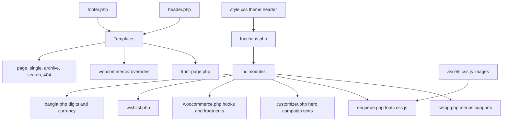

# Orpitey Fashion - WordPress/WooCommerce Theme Plan

## Source design (from the Lovable preview)
- Brand: Orpitey Fashion, Bangla-language store for saree (শাড়ি) and three-piece (থ্রি-পিস).
- Fonts (Google): `Hind Siliguri` 300-700 for body and UI, `Noto Serif Bengali` 400-700 for headings.
- Colour tokens (keep as CSS custom properties, same oklch values):
  - `--background: oklch(97.5% .016 86)` (cream), `--soft: oklch(95.5% .02 82)`, `--card: oklch(99% .009 86)`
  - `--primary: oklch(31% .112 24)` (maroon), `--primary-foreground: oklch(97.5% .016 86)`
  - `--gold: oklch(73% .11 77)`, `--gold-light: oklch(85% .1 85)`, `--accent: oklch(75% .105 79)`
  - `--foreground: oklch(24% .028 45)`, `--muted-foreground: oklch(49% .03 49)`, `--border: oklch(84% .025 69)`
  - `--footer: oklch(20% .039 48)` (dark brown), `--footer-foreground: oklch(95% .02 83)`, `--product-success: oklch(43% .09 150)`
- Homepage sections, in order:
  1. Maroon announcement bar ("সারাদেশে হোম ডেলিভারি · ৫,০০০ টাকার বেশি অর্ডারে ডেলিভারি ফ্রি")
  2. Sticky header: left menu (শাড়ি, থ্রি-পিস, নতুন সংগ্রহ), centred script logo, right icons (search, wishlist, bag with count)
  3. Full-bleed hero image with dark overlay, gold eyebrow line, serif H1, text, gold CTA button
  4. Three trust badges strip (fast delivery, easy exchange, quality assured)
  5. "প্রিয় সংগ্রহ" product grid with filter tabs (সব / শাড়ি / থ্রি-পিস), 4 columns, badge, wishlist heart, hover add-to-bag
  6. Split campaign block: image (3fr) plus maroon panel (2fr) with grid pattern and outlined gold button
  7. "Orpitey Journal" centred intro
  8. Dark-brown footer: logo and tagline, Support links, Follow-us text, copyright row
  9. Slide-out cart drawer from the right ("আপনার ব্যাগ")
- Product page: breadcrumb, vertical thumbnail gallery plus main image with badge, category line, serif title, rating, stock status, price, description, colour swatches, size buttons plus size guide, quantity stepper, maroon "ব্যাগে যোগ করুন" button, outlined "অর্ডার করুন" button, three trust icons, accordions (details, delivery and exchange, care), related products.

## Architecture

## File structure (in `fashion-theme/`)
- `style.css` (theme header only), `functions.php`, `screenshot.png`
- `inc/`: `setup.php`, `enqueue.php`, `customizer.php`, `template-tags.php`, `woocommerce.php`, `wishlist.php`, `bangla.php`
- `assets/css/`: `tokens.css` (variables, fonts), `base.css`, `components.css` (buttons, cards, badges, forms), `layout.css` (header, footer, drawer), `woocommerce.css`
- `assets/js/`: `main.js` (mobile menu, search overlay, drawer, accordions, filter tabs), `product.js` (gallery, swatches, qty), `wishlist.js`
- `assets/images/`: logo, hero, campaign and 3 product images downloaded from the preview (used as defaults and demo content)
- `template-parts/`: `announcement-bar.php`, `site-header.php`, `cart-drawer.php`, `product-card.php`, `trust-badges.php`, `section-*.php` for each homepage section
- Templates: `header.php`, `footer.php`, `front-page.php`, `index.php`, `page.php`, `single.php`, `archive.php`, `home.php` (journal), `search.php`, `404.php`, `page-templates/page-contact.php`, `page-templates/page-policy.php`, `page-templates/page-wishlist.php`
- `woocommerce/` overrides: `archive-product.php`, `content-product.php`, `single-product.php`, `content-single-product.php`, `cart/cart.php`, `checkout/form-checkout.php`, `checkout/thankyou.php`, `myaccount/` (form-login, navigation, dashboard), `global/breadcrumb.php`
- `setup/demo-import.php` (WP-CLI command that creates categories, attributes, sample products, pages and menus)

## Key implementation decisions
- Classic PHP theme, plain CSS with custom properties (no Tailwind build step), vanilla JS.
- Products: WooCommerce variable products using global attributes `pa_color` (with a swatch hex term meta) and `pa_size` (S, M, L, XL). The subtitle line (for example "সফট কটন · সূক্ষ্ম কারুকাজ") comes from a product meta field, and badges (নতুন, বিশেষ মূল্য, বেস্টসেলার) from product tags or sale status.
- Cart drawer: AJAX add-to-cart plus `woocommerce_add_to_cart_fragments` to refresh the drawer and the bag count. "অর্ডার করুন" adds to cart, then redirects to checkout.
- Wishlist: built-in, no plugin. Uses localStorage for guests and user meta for logged-in users, and a Wishlist page template renders the saved items.
- Bangla localisation: currency BDT with the ৳ symbol, a filter that converts prices, counts and dates to Bengali digits, and all theme strings wrapped in `__()` with text domain `orpitey`.
- Customizer: announcement text, hero image, eyebrow, title, text and CTA, trust badge texts, campaign image and text, journal intro, footer tagline and social links.
- Menus: `primary` (header left), `footer-support`, plus a mobile off-canvas menu.
- Responsive: match the Lovable breakpoints (hero min-height 570px, or 680px from the sm breakpoint up; grid of 2 columns on mobile and 4 on desktop; campaign section stacked on mobile).

## Extended pages (same design language)
- Shop / category archive: page hero banner, filter tabs by category, sort dropdown, product-card grid, pagination.
- Cart and checkout: cream cards, maroon primary buttons, order summary card; the thank-you page gets a success panel.
- My Account: styled login/register card, sidebar navigation, orders table.
- Content pages: About, Contact (form plus info), Delivery info, Exchange policy, all using a policy template with a serif heading.
- Journal: post card grid on `home.php` and a single post with a large serif title.
- Search results (products first, then posts) and a branded 404 page.

## Verification
- Activate the theme, run the demo import, and compare every page side by side with the Lovable preview at desktop and mobile widths.
- Test add to cart, the drawer, buy now, checkout with Cash on Delivery, the wishlist, and variation selection.
